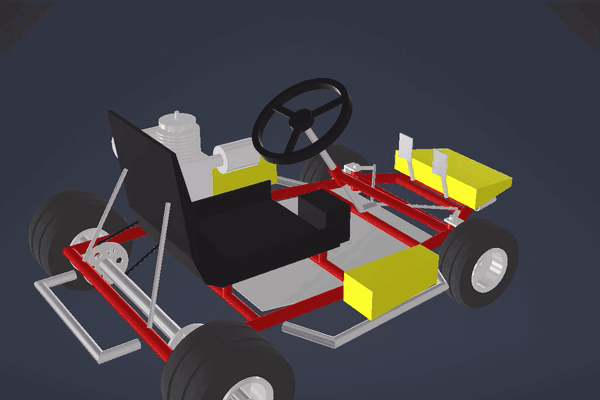
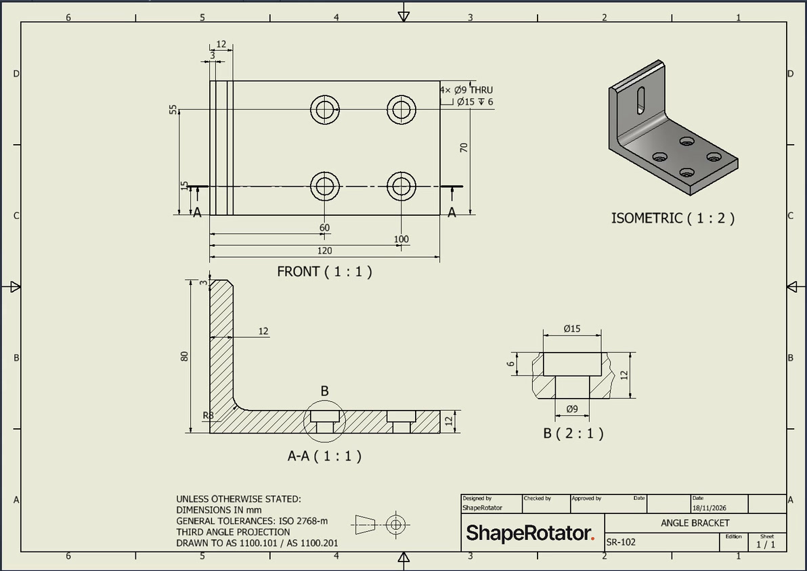
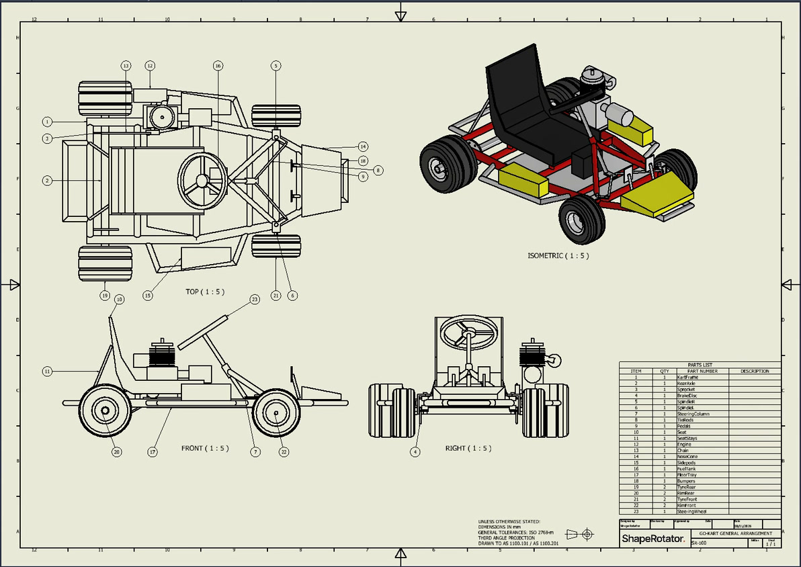
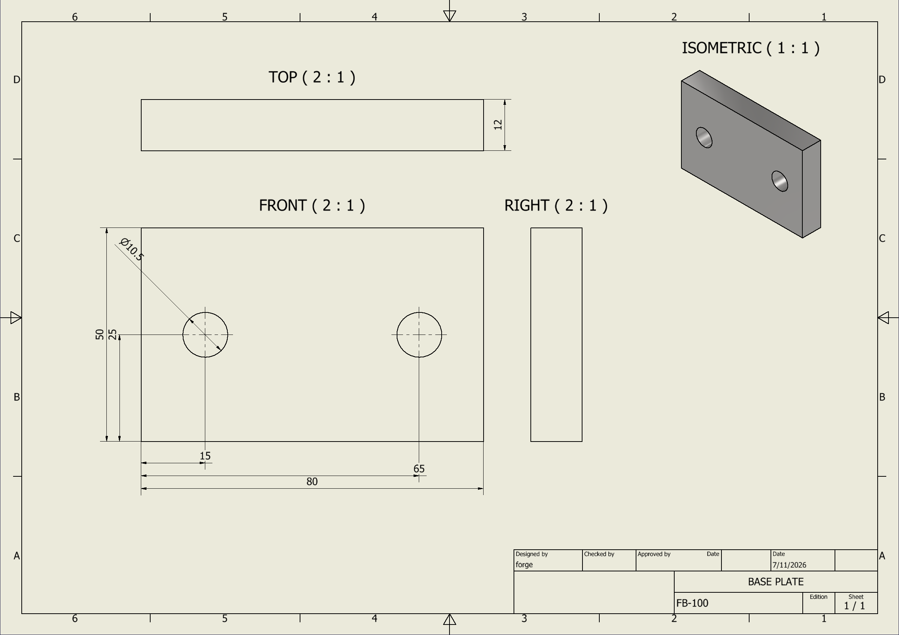
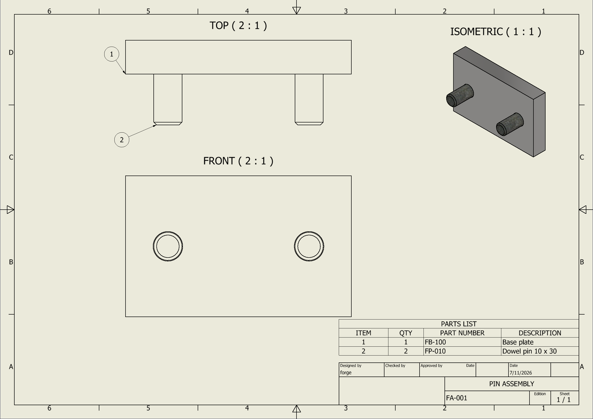
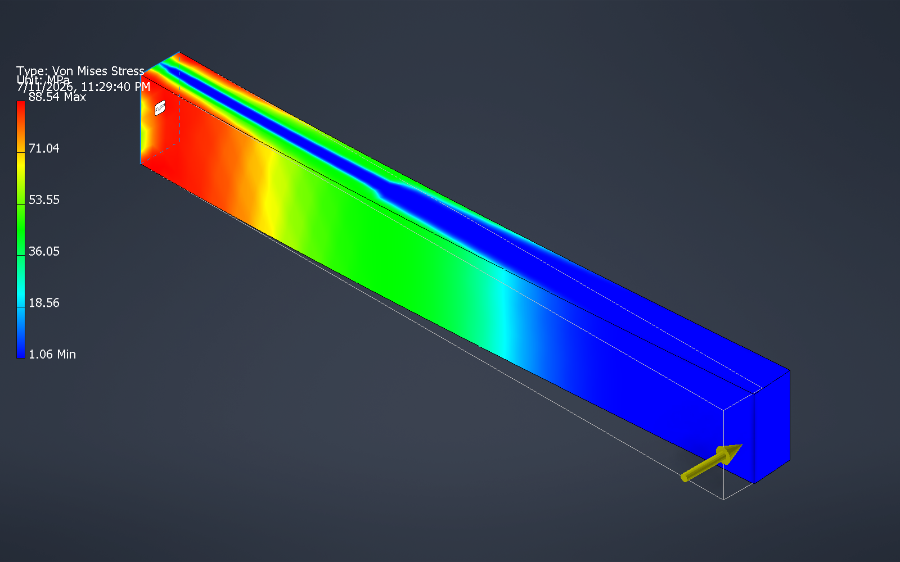

# inventor-forge

inventor-forge is an MCP server and Python library that gives AI agents control of Autodesk Inventor. Its 207 tools
cover parametric parts, sheet metal, assemblies, drawings to AS 1100, ISO, ASME, DIN, BS 8888, JIS or GB with an
automatic QA check, materials and mass properties, all through Inventor's COM API. Stress and modal analysis run in
Inventor's Stress Analysis environment, which has no API and is therefore driven with the mouse and keyboard, as
described under [Implementation notes](#implementation-notes).

> **Mouse and keyboard use.** `analyze_stress` and `analyze_modes` take control of the mouse and keyboard for 30 to
> 60 seconds, because Inventor's Stress Analysis has no API. Before any input is sent, the tool returns a notice that
> the agent must show to the user, and it runs only when called again with `user_notified=true` after the user agrees.
> During the run, Inventor must remain visible and the mouse must not be used; a click that would land outside
> Inventor stops the run. All other tools work through the API alone.

It is written from Inventor's type library and API documentation. Any MCP client that communicates over stdio can use
it. It is also the Inventor backend of the [ShapeRotator](https://github.com/RobertBarnettProjects/hermes-shaperotator)
plugin for Hermes Agent, which installs it on first use.



*A go-kart built through inventor-forge: a welded round-tube frame from 3D centre lines (`tube_frame`, AS/NZS 1163 CHS
sizes), then 27 components placed in an assembly with an interference check.*

| | |
|---|---|
|  |  |
| A detail drawing: section A-A, detail B, hole notes and general notes to AS 1100, checked by the drawing QA | `make_assembly_sheet` on the kart: four views, 23-item parts list, balloons |
|  |  |
| `make_part_sheet`, with no QA issues: third-angle views clear of the title block, retrieved and hole-position dimensions, centre marks, labels, and a title block filled from iProperties | `make_assembly_sheet`: a general arrangement with the parts list above the title block, and balloons |



`analyze_stress` in Inventor's Stress Analysis on a 150 × 20 × 10 mm mild-steel cantilever with a 200 N
tip load, run end to end by the tool: 0.611 mm tip deflection (beam theory 0.614 mm), peak 88.5 MPa
(theory 90 MPa) at mesh 0.04 (83.9 MPa at Inventor's default 0.1), reaction 200 N / 30.0 N·m (= 200 N ×
150 mm), equilibrium error 0.0 %.

## Install

Requirements: Windows, Autodesk Inventor (tested with 2027), and Python 3.10 or later with `pywin32`. Analysis requires
Inventor's Stress Analysis add-in (Inventor Professional) and a visible Inventor window.

```bash
pip install pywin32
```

Claude Code:

```bash
claude mcp add inventor-forge -- python -X utf8 -m inventor_forge.server
```

Run this from the repository folder, or add `--env PYTHONPATH=<path to this folder>`. Other MCP clients are configured
the same way: command `python`, arguments `["-X", "utf8", "-m", "inventor_forge.server"]`. Add `--hidden` to start
Inventor without a window when it is not already running.

The only third-party dependency is pywin32; the MCP protocol layer, the dialog driver and the report parser are
written in plain Python.

## Architecture

- **Single COM apartment.** Every call runs on one single-threaded apartment (STA) thread, so the server is safe to
  use from asynchronous MCP hosts and multi-threaded agents.
- **Units.** Inventor's API works in centimetres and radians; every tool accepts and returns millimetres, degrees,
  newtons, megapascals and kilograms.
- **Constants from the type library.** All 5,000+ `k…` enumeration values are read from Inventor's type library at
  run time rather than hard-coded.
- **Typed calls where late binding is insufficient.** Methods with `[out]` parameters (mass inertia, evaluator
  queries, geometry proxies) and indexed properties (`DrawingCurves`) are invoked with explicit COM types.
- **Feature deltas.** Every feature reports its change, for example `Hole1 | V 92199 (-3801 mm³) | F10 E20`, so the
  agent can check the result against a hand calculation. A feature that does not change the volume is flagged.
- **Direction-independent cuts and holes.** Cut extrusions and holes use the side that removes material, so the agent
  does not need to know Inventor's sketch-normal conventions.
- **Tool profiles for clients.** Each tool's `_meta` carries a `cad/*` profile: whether it changes the
  model's shape, takes over the mouse and keyboard, or runs code; which arguments name files it writes or reads; and
  how long a call may take for the arguments given. `initialize` advertises it under
  `capabilities.experimental["cad/profile"]`. A client can then refresh previews, inform the user, restrict writes and
  set its time limits without hard-coding any of it (`inventor_forge/profile.py`).
- **Write scope.** A call may carry `_meta["cad/write_scope"]` = `{"dirs": [...], "files":
  [...]}`. Every write is checked against it at the moment it happens, with links followed and the final name (an
  added extension, a `.dwg` fallback): saves include the changed documents an assembly or drawing also writes.
  Anything outside is refused before a file is touched, and the refusal lists every such path after
  `cad/needs_approval:`, so a client can ask the user about all of them and send the call again. Forge's own temporary
  files are always allowed; without a scope, only the protected folders apply.
- **Session-owned Inventor instances.** An Inventor that the server starts belongs to the session. When the client
  closes the connection, it is closed; if it holds unsaved changes, it is made visible and left open instead. An
  Inventor that the session only attached to is never closed.
- **Progress notifications.** A call that carries an MCP progress token receives a notification every 10 seconds
  describing the current step (a solve's elapsed time, the current case of a batch), so a client can distinguish a
  long solve from an unresponsive server.

## Tools (207)

Full reference with arguments: [TOOLS.md](TOOLS.md).

- **Session / documents**: connect, status, list/activate/open/save/close documents, export (STEP, IGES,
  STL, SAT, Parasolid, OBJ, JT, 3MF, PDF/DWG/DXF), set_view, screenshot (returned to the model as an
  image), transaction (begin/commit/abort undo groups), undo.
- **Sketch**: create_sketch (base plane, offset plane or planar face, reporting where sketch x/y point),
  rectangle, circle, line, arc, polygon (across-flats reported), closed polyline profile, slot, hole-centre
  points, dimensioned so they stay parametric; separately drawn lines and arcs join up automatically;
  geometric constraints and driving dimensions on any curve, offset, project model edges; sketch_info.
- **Features**: extrude (join/cut/intersect/new body, through all, taper), revolve (about X/Y/Z, a work
  axis or a construction line), hole (several centres at once; drilled, tapped ISO metric,
  counterbored, countersunk; blind or through), hole_linear (from two edges), fillet, chamfer (distance,
  two distances, distance + angle), circular / rectangular pattern, mirror, shell, cosmetic thread,
  sweep, loft, coil, face draft, thicken, split / trim, combine bodies, engraved or embossed text,
  work planes/axes, list / delete / suppress features.
- **Standard parts**: create_standard_part: hex bolts (ISO 4017), socket screws (ISO 4762), hex nuts
  (ISO 4032), washers (ISO 7089) and dowels (ISO 2338), M3–M24, with part number and description filled in.
- **Inspect**: inspect (volume, area, bbox, mass), list_faces (type, area, centroid, outward normal,
  cylinder diameter/axis, hole yes/no), list_edges, find_face / find_edge (by point and/or normal),
  mass_properties (mass, CoG, inertia tensor, principal moments), measure (min distance, angle).
- **Parameters**: get / set / add parameters, list_dimensions, edit_dimension.
- **Materials & iProperties**: list_materials, set_material (returns E, ν, density, yield, UTS);
  get / set iProperties (part number, description, designer… and custom properties).
- **Sheet metal**: thickness and bend radius, face, flange, cut, flat_pattern (blank size + DXF for
  laser/plasma).
- **Assembly**: place_component (position + rotation, grounded), add_constraint (mate, axis-to-axis
  for cylinders, flush, angle, insert, tangent; faces/edges by part index or origin planes/axes),
  ground / move component, circular and linear component patterns, inspect_assembly (components, constraint health, per-component face tables),
  check_interference (pairs + overlap volume), bill_of_materials (+ CSV), copy_assembly, list_references (an audit of
  every file reference: found elsewhere through the project search, substituted, missing), replace_reference
  (repoint a file or a whole folder, with backups and a read-back check).
- **Standards**: list_standards, set_standard, get_standard: the agent asks once per session which standard to
  work to (AS 1100, ISO, ASME, DIN, BS 8888, JIS, GB); drawings use its template, projection angle and dimension style.
- **Drawings**: create_drawing (to the session's standard: AS 1100 / ASME / JIS third-angle, ISO / DIN / BS 8888 / GB first-angle), sheets,
  base / projected / section / detail views, move / rescale views, linear and diameter dimensions,
  auto_dimension_view (retrieve model dimensions), tolerances and fits, surface finish, centre marks, hole notes,
  hole tables, revision tables, general notes, parts list, auto_balloon, title block fields, view labels, **make_part_sheet / make_assembly_sheet** (one-shot
  sheets: the main view faces the holes, long parts lie down, tilted parts are viewed square, cross holes get a section,
  thread and spline-hole callouts are placed clear of other text, GA sheet size can be chosen automatically, AS 1100
  projection symbol), add_projection_symbol, set_view_component_visibility, **check_drawing** (QA), render_sheet
  (image back to the model), export_pdf.
- **Analysis**: analyze_stress, analyze_modes (Inventor Stress Analysis, parts and assemblies: automatic contacts of a chosen type, Fixed / Frictionless / Pin supports, force, pressure, gravity, bearing, moment and remote-force loads, local mesh control, Inventor's own mesh refinement, a chosen model state), read_stress_report, exit_analysis. Several faces are picked from one view where possible. Once a study exists, no mouse is needed: list_studies, activate_study, copy_study, rename_study, delete_study_item, list_analysis_parameters, set_analysis_parameters, solve_study, read_result_maximum, show_result, set_result_colors, study_report (whole file, or one study), run_study_cases (a resumable table of load cases that restarts a crashed private Inventor), set_contact_type, mesh_convergence, result_at_point (a result's value at a spot, read off the colour scale), refresh_analysis_display. solve_state watches any Inventor using Windows calls only.
- **Frames**: tube_frame (welded round-tube frames from 3D centre lines, AS/NZS 1163 CHS sizes, with a cut list) and frame_members (welded box-section frames from member centre lines, with a cut list of lengths, mitre angles and stock lengths).
- **Parametric**: link_parameters (master part), parametric_extrusion (fully constrained, expression-driven), model states, named faces, split_faces, check_assembly, component_gap.
- **Concurrent use**: connect(private=true) runs in a separate Inventor process; tools refuse to call Inventor during a solve, and read-only tools retry when it is busy.
- **3D printing and multi-body parts**: export_print_package (native + STL + 3MF + STEP in mm, written atomically,
  every mesh checked for shells, open edges, extents and bed contact; a millimetre 3MF from the mesh when Inventor's
  translator can't), export_capabilities, list_bodies, `body=` on extrude / hole / fillet / chamfer / find_edge /
  find_face / measure with per-body volume deltas, body_gap, pose_bodies (clearances and a picture of another
  arrangement without changing the part).
- **Batch operations**: select_edges / select_faces (filters on the server, indices back), parametric_profile (lines, arcs,
  circles, extruded or revolved in one call), batch (one undo step, named outputs, rollback on the first failure),
  set_output (compact results, per-call timings).
- **Reading**: read_pdf_text (standard library only).
- **System**: execute_python (persistent namespace with live Inventor objects), reload_api,
  list_tools.

## Reference guides

Concise notes on Inventor's behaviour, written for the model using the tools: `guide(topic)` returns one, and MCP
clients can read them as resources (`inventor-forge://guide/<topic>`). Topics: session (working alongside the user,
hangs, COM binding, unattended runs), modelling, assemblies, stress-analysis, drawings, printing. They live in
[inventor_forge/guides](inventor_forge/guides).

## Reliability in long sessions

- The session is pinned to the Inventor process it connected to; it never moves to another one by itself.
- Private starts are serialised across processes by a lock file and quit what they started if they can't identify it.
- A call that stops making progress (the window is not responding, or Inventor and its solver use no processor time)
  produces a warning after 2 minutes and is abandoned after 10 (`INVENTOR_FORGE_HANG_WARN`, `INVENTOR_FORGE_HANG_STOP`).
- A Stress Analysis solve is stopped, rather than left to reach its time limit, when Inventor and its solver processes
  use under 1 % of a core for 15 minutes or Inventor stops responding for 10 minutes (`INVENTOR_FORGE_STALL_S`,
  `INVENTOR_FORGE_HUNG_S`). The solver processes are ended; a hung Inventor is closed only if the session started it.
- "Busy" refusals are retried by a COM message filter; a call that fails the same way twice is not sent again.
- Long calls keep the PC awake; at most two solves run at once (`INVENTOR_FORGE_MAX_SOLVES`).
- `connect` checks the active project (`expect_project` / `INVENTOR_FORGE_PROJECT`), unsaved documents and disk space.

## Implementation notes

- **Stress and modal analysis.** Inventor's Stress Analysis environment has no automation API (its add-in exposes no
  objects, and its solver runs only inside Inventor), so `analyze_stress` and `analyze_modes` operate it through the
  user interface, **taking control of the mouse and keyboard for about 30 seconds**:
  - commands (Create Study, Fixed Constraint, Force, Pressure, Gravity, Mesh Settings, Simulate, Report)
    are started through the API;
  - each face, identified by the same index as `list_faces`, is selected with a real click: the camera is turned to
    look directly at an interior point of the face, the tool waits for the view to redraw, clicks the centre of the
    viewport, and confirms on screen that the face has changed to the selection colour (a click that only activated
    Inventor's window is detected and repeated);
  - values are typed into Inventor's value boxes with the keyboard; plain fields and buttons are set with
    window messages;
  - every click is first checked to land on Inventor's viewport or dialog; if anything covers it, the run stops
    rather than clicking elsewhere;
  - results are read from Inventor's report for the study just run: von Mises and principal stresses, displacement,
    safety factor and reactions, with an **equilibrium check** and a **reaction-moment check** that detects a selection
    on the wrong face, plus an image of Inventor's stress plot.
  Use `mesh_fraction` (0.04–0.05) for a second, finer run to check convergence.
- **Drawing QA.** The check reports views overlapping each other, the title block or the
  border; parts lists, hole tables and revision tables overlapping things or running off the sheet; dimension
  text off the sheet, on the title block or overlapping other dimension text; hole notes sitting on a view;
  overall sizes with no dimension (a bore of the same size doesn't count as a height); views without
  dimensions; missing labels; empty title-block fields; assemblies without a parts list or with unballooned
  items. Ends with `TOTAL ISSUES: N`.
- **Dimensioning of round parts.** On one-call sheets, equal holes get one grouped callout (`6× Ø14 THRU ON
  Ø110 PCD`, with counterbores), concentric sizes get diameters, steps and overall sizes are added, and a
  neighbouring view slides over if a callout needs the room.
- **Unattended exports.** Translators run in Inventor's silent mode, and a watchdog cancels and reports any options
  dialog that still appears, so an unattended session cannot be blocked.
- **Sheet layout.** Views are placed clear of the title block with space reserved for dimensions, and the projection
  angle follows the selected standard.
- **Material data.** E, ν, density, yield and ultimate strength are read from Inventor's asset library with units
  normalised; mass properties include inertia.
- **Images in results.** Screenshots and sheet renders are returned as images in the MCP result, so the model can
  review its own work.

## Validation

The offline tests in `tests/` run without Inventor (`python -m pytest tests`). The live `smoke_*.py` and `live_*.py`
scripts exercise the tools against Inventor with hand-calculated checks; those that call `analyze_stress` or
`analyze_modes` (such as `smoke_fea.py`, `smoke_fea2.py` and `smoke_full.py`) take control of the mouse and keyboard
while they run.

| Check | Result |
|---|---|
| 120 × 80 × 10 plate, 4 × Ø11 through holes | Δ −3801 mm³ = 4π·5.5²·10 ✓ |
| M12×1.75 tapped hole (10 mm) | Δ −802 mm³ (Inventor's minor-diameter model) ✓ |
| R3 fillet on an 80 mm edge | Δ −155 mm³ = (1−π/4)·9·80 ✓ |
| Cantilever 150 × 20 × 10 mild steel, 200 N (Inventor Stress Analysis, live) | δ 0.611 vs 0.614 mm, σ 88.5 vs 90 MPa (mesh 0.04), reaction moment 30.0 vs 30.0 N·m, modes 383 / 755 / 2356 vs 380 / 760 / 2382 Hz |
| Pressure 0.1 MPa on a cantilever (live) | reaction 300 N, deflection 0.343 vs 0.345 mm |
| Gravity (live) | reaction 2.31 N = part weight, equilibrium 0.0 % |
| Beam fixed at both ends (live) | reaction 1000 N, deflection 0.0247 vs 0.024 mm |
| Plate fixed by the wall of a hole (live) | reaction moment 3.9993 vs 4.0 N·m |
| Report parser (offline, an Inventor report with three studies) | reads the requested study, not the first |
| Sheet-metal tray 100 × 60 × 2 + 25 mm flange | flat pattern 100 × 81.5 mm, DXF written |
| Base plate + 2 pins, mate + flush | constraints healthy, interference clear, BOM 1 + 2 |
| Part sheet / GA sheet | QA 0 issues, PDF exported |
| Flange sheet (revolved part, 6 counterbored holes) | grouped callout with PCD, Ø150 / Ø70 / Ø40, height 40, step 24, QA 0 |
| Standard parts | M10 bolt, M8 socket screw, washer: volumes within 1 % of hand calculation |
| Coil 5 turns, Ø2 wire on Ø20 | 987 mm³ vs ~989 mm³ |
| Drawing export | PDF, DWG, DXF without any prompt (one file per sheet) |

## Licence

MIT; see [LICENSE](LICENSE). Autodesk and Inventor are trademarks of Autodesk, Inc.; this project is
not affiliated with or endorsed by Autodesk.

## Environment variables

| Variable | Effect |
|---|---|
| `INVENTOR_FORGE_READ_ONLY=1` | Refuse every tool that changes a model, and every file write (exports, CSV, screenshots). |
| `INVENTOR_FORGE_TOOLSETS=sketch,features,drawing` | Offer only these tool groups (system and session tools stay). |
| `INVENTOR_FORGE_PROTECTED=C:\Vault;D:\Released` | Never save or export into these folders (Autodesk's library, template and install folders are always protected). |
| `INVENTOR_FORGE_DEBUG=1` | Extra diagnostics on stderr. |
| `INVENTOR_FORGE_WORKDIR=<folder>` | Where relative output paths go (default `~/Documents/inventor-forge`). |
| `INVENTOR_FORGE_VISIBLE=0` | Start Inventor hidden when it isn't running (same as `--hidden`). |
| `INVENTOR_FORGE_PRIVATE=1` | Start a separate Inventor for the session instead of attaching to one the user has open (`connect(private=false)` attaches on request). |
| `INVENTOR_FORGE_MAX_SOLVES=2` | Solves allowed at once on the PC. |
| `INVENTOR_FORGE_MIN_FREE_GB=6` | Free memory a solve needs to start beside others. |
| `INVENTOR_FORGE_STALL_S=900` | Seconds of near-zero processor use after which a solve is stopped as stalled. |
| `INVENTOR_FORGE_HUNG_S=600` | Seconds Inventor may stop responding during a solve before the solve is stopped. |

Each tool's `_meta["cad/files"]` in `tools/list` states which arguments it writes or reads, for clients that restrict
file access (also published as `inventor-forge/files`).
