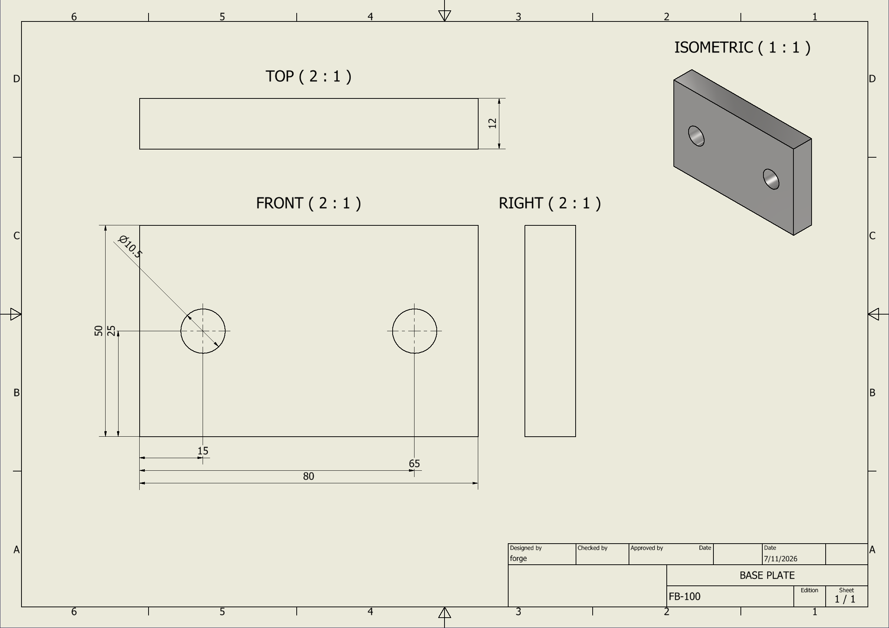
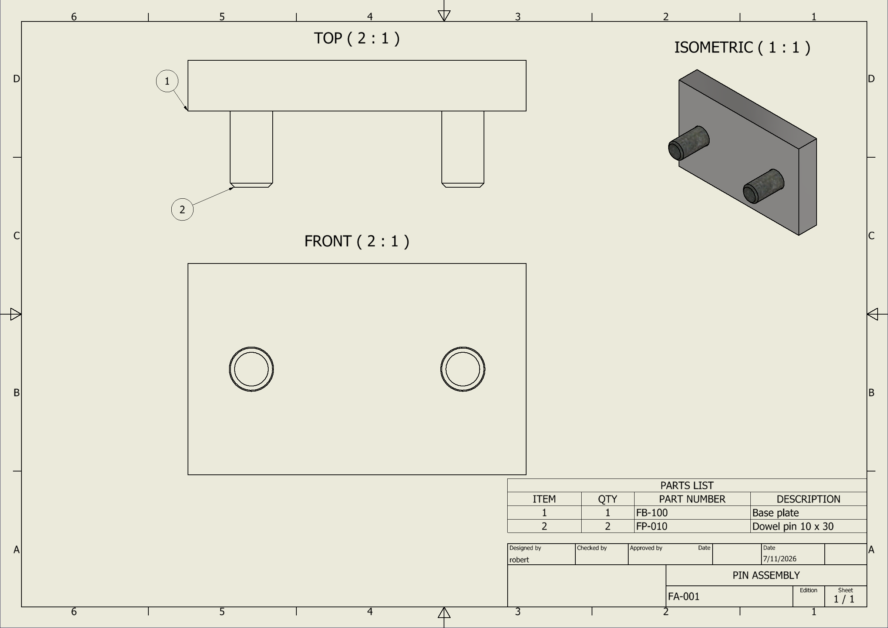
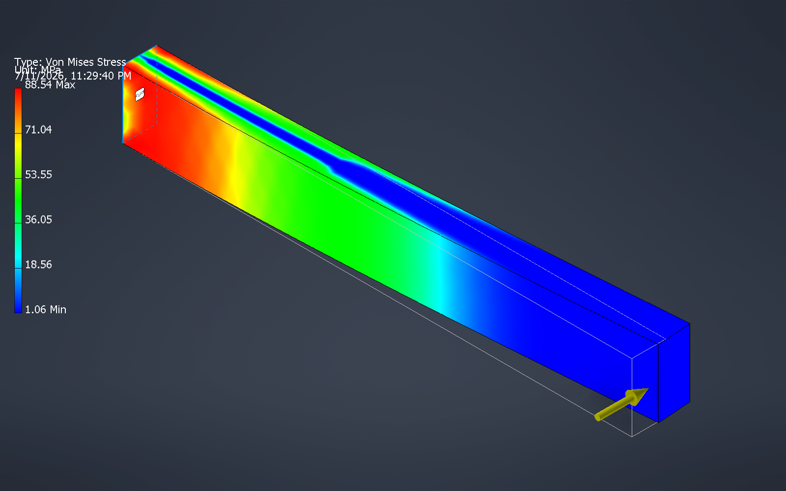

# inventor-forge

**Autodesk Inventor for AI agents** — an MCP server (and Python library) with 160 tools: parametric
parts, sheet metal, assemblies, AS 1100 / ISO drawings with automatic QA, materials and mass
properties — all through Inventor's COM API — and stress / modal analysis in Inventor's own Stress
Analysis environment, which has no API and is therefore driven with the mouse and keyboard (below).

> **⚠ Mouse and keyboard notice.** `analyze_stress` and `analyze_modes` take over the mouse and keyboard
> for 30–60 s, because Inventor's Stress Analysis has no API. Before anything moves, the tool returns a notice that
> the agent must show you, and it only runs once called again with `user_notified=true` after your go-ahead.
> During the run, keep Inventor visible and don't touch the mouse; a click that would land outside Inventor
> stops the run. Every other tool works purely through the API.

It is written from Inventor's type library and API documentation. It also powers the Inventor backend of the hermes-cad plugin for Hermes Agent.

| | |
|---|---|
|  |  |
| `make_part_sheet` → QA 0 issues: third-angle views clear of the title block, retrieved + hole-position dimensions, centre marks, labels, title block from iProperties | `make_assembly_sheet`: GA with parts list above the title block and balloons |



`analyze_stress` in Inventor's Stress Analysis on a 150 × 20 × 10 mm mild-steel cantilever with a 200 N
tip load, run end to end by the tool: 0.611 mm tip deflection (beam theory 0.614 mm), peak 88.5 MPa
(theory 90 MPa) at mesh 0.04 (83.9 MPa at Inventor's default 0.1), reaction 200 N / 30.0 N·m (= 200 N ×
150 mm), equilibrium error 0.0 %.

## Install

Requirements: Windows, Autodesk Inventor (tested on 2027), Python 3.10+ with `pywin32`.
Analysis needs Inventor's Stress Analysis add-in (Inventor Professional) and a visible Inventor window.

```bash
pip install pywin32
```

Claude Code:

```bash
claude mcp add inventor-forge -- python -X utf8 -m inventor_forge.server
```

(run from this folder, or add `--env PYTHONPATH=<path to this folder>`). Any MCP client works the same way:
command `python`, args `["-X", "utf8", "-m", "inventor_forge.server"]`. Add `--hidden` to start Inventor
invisibly when it isn't already running.

No third-party Python packages beyond pywin32: the MCP protocol layer, the dialog driver and the
report parser are plain Python.

## How it works

- **One COM apartment.** Every call runs on a single STA thread, so it is safe from async MCP hosts and
  multi-threaded agents.
- **Units at the edge.** Inventor's API is in centimetres and radians; every tool takes and returns mm,
  degrees, N, MPa, kg.
- **Constants from the type library.** All 5,000+ `k…` enum values are read from Inventor's own type
  library at run time — no hard-coded magic numbers.
- **Typed calls where late binding can't.** Methods with `[out]` parameters (mass inertia, evaluator
  queries, geometry proxies) and indexed properties (`DrawingCurves`) are invoked with explicit COM types.
- **Every feature reports a delta** — `Hole1 | V 92199 (-3801 mm³) | F10 E20` — so the agent can check
  the result against a hand calculation; a feature that doesn't change the volume is flagged.
- **Direction-agnostic cuts and holes.** Cut extrusions and holes try the side that actually removes
  material, so the agent doesn't have to know Inventor's sketch-normal conventions.

## Tools (160)

Full reference with arguments: [TOOLS.md](TOOLS.md).

- **Session / documents** — connect, status, list/activate/open/save/close documents, export (STEP, IGES,
  STL, SAT, Parasolid, OBJ, JT, 3MF, PDF/DWG/DXF), set_view, screenshot (returned to the model as an
  image), transaction (begin/commit/abort undo groups), undo.
- **Sketch** — create_sketch (base plane, offset plane or planar face, reporting where sketch x/y point),
  rectangle, circle, line, arc, polygon (across-flats reported), closed polyline profile, slot, hole-centre
  points — dimensioned so they stay parametric; separately drawn lines and arcs join up automatically;
  geometric constraints and driving dimensions on any curve, offset, project model edges; sketch_info.
- **Features** — extrude (join/cut/intersect/new body, through all, taper), revolve (about X/Y/Z, a work
  axis or a construction line), hole (several centres at once; drilled, tapped ISO metric,
  counterbored, countersunk; blind or through), hole_linear (from two edges), fillet, chamfer (distance,
  two distances, distance + angle), circular / rectangular pattern, mirror, shell, cosmetic thread,
  sweep, loft, coil, face draft, thicken, split / trim, combine bodies, engraved or embossed text,
  work planes/axes, list / delete / suppress features.
- **Standard parts** — create_standard_part: hex bolts (ISO 4017), socket screws (ISO 4762), hex nuts
  (ISO 4032), washers (ISO 7089) and dowels (ISO 2338), M3–M24, with part number and description filled in.
- **Inspect** — inspect (volume, area, bbox, mass), list_faces (type, area, centroid, outward normal,
  cylinder diameter/axis, hole yes/no), list_edges, find_face / find_edge (by point and/or normal),
  mass_properties (mass, CoG, inertia tensor, principal moments), measure (min distance, angle).
- **Parameters** — get / set / add parameters, list_dimensions, edit_dimension.
- **Materials & iProperties** — list_materials, set_material (returns E, ν, density, yield, UTS);
  get / set iProperties (part number, description, designer… and custom properties).
- **Sheet metal** — thickness and bend radius, face, flange, cut, flat_pattern (blank size + DXF for
  laser/plasma).
- **Assembly** — place_component (position + rotation, grounded), add_constraint (mate — axis-to-axis
  for cylinders — flush, angle, insert, tangent; faces/edges by part index or origin planes/axes),
  ground / move component, circular and linear component patterns, inspect_assembly (components, constraint health, per-component face tables),
  check_interference (pairs + overlap volume), bill_of_materials (+ CSV).
- **Drawings** — create_drawing (AS 1100 third-angle with decimal points, or ISO first-angle), sheets,
  base / projected / section / detail views, move / rescale views, linear and diameter dimensions,
  auto_dimension_view (retrieve model dimensions), tolerances and fits, surface finish, centre marks, hole notes,
  hole tables, revision tables, general notes, parts list, auto_balloon, title block fields, view labels, **make_part_sheet / make_assembly_sheet** (one-shot
  sheets: the main view faces the holes, long parts lie down, tilted parts are viewed square, cross holes get a section,
  thread and spline-hole callouts are placed clear of other text, GA sheet size can be chosen automatically, AS 1100
  projection symbol), add_projection_symbol, set_view_component_visibility, **check_drawing** (QA), render_sheet
  (image back to the model), export_pdf.
- **Analysis** — analyze_stress, analyze_modes (Inventor Stress Analysis, parts and assemblies: automatic contacts of a chosen type, Fixed / Frictionless / Pin supports, force, pressure, gravity, bearing, moment and remote-force loads, local mesh control, Inventor's own mesh refinement, a chosen model state), read_stress_report, exit_analysis. Several faces are picked from one view where possible. Once a study exists, no mouse is needed: list_studies, activate_study, copy_study, rename_study, delete_study_item, list_analysis_parameters, set_analysis_parameters, solve_study, read_result_maximum, show_result, set_result_colors, study_report (whole file, or one study), run_study_cases (a resumable table of load cases that restarts a crashed private Inventor), set_contact_type, mesh_convergence, result_at_point (a result's value at a spot, read off the colour scale), refresh_analysis_display. solve_state watches any Inventor using Windows calls only.
- **Frames** — frame_members: a welded box-section frame from member centre lines in one call, with a cut list (lengths, mitre angles, stock lengths).
- **Parametric** — link_parameters (master part), parametric_extrusion (fully constrained, expression-driven), model states, named faces, split_faces, check_assembly, component_gap.
- **Working alongside the user** — connect(private=true) runs in a separate Inventor process; tools refuse to call Inventor during a solve, and read-only tools retry when it is busy.
- **Reading** — read_pdf_text (standard library only).
- **System** — execute_python (persistent namespace with live Inventor objects), reload_api,
  list_tools.

## How the harder parts work

- **Stress and modal analysis in Inventor's own Stress Analysis.** That environment has no automation
  API (its add-in exposes nothing, and its bundled solver only runs inside Inventor), so
  `analyze_stress` / `analyze_modes` drive it the way a person would, **taking over the mouse and
  keyboard for ~30 s**:
  - commands (Create Study, Fixed Constraint, Force, Pressure, Gravity, Mesh Settings, Simulate, Report)
    are started through the API;
  - each face — chosen by the same index as `list_faces` — is picked with a real click: the camera is
    turned to look straight at an interior point of the face, the tool waits for the screen to redraw,
    clicks the centre of the viewport, and confirms on screen that the face turned to the selection colour
    (a click that only activated Inventor's window is detected and repeated);
  - values are typed into Inventor's value boxes with the keyboard; plain fields and buttons are set with
    window messages;
  - every click is checked to land on Inventor's viewport/dialog first — if anything covers it, the run
    stops instead of clicking elsewhere;
  - results come from Inventor's own report (parsed for the study just run): von Mises and principal
    stresses, displacement, safety factor, reactions — with an **equilibrium check** and a **reaction-moment
    check** that catches a pick that went to the wrong face — plus a picture of Inventor's stress plot.
  Use `mesh_fraction` (0.04–0.05) for a second, finer run to check convergence.
- **Drawing QA that looks at what matters:** views overlapping each other, the title block or the
  border; parts lists, hole tables and revision tables overlapping things or running off the sheet; dimension
  text off the sheet, on the title block or overlapping other dimension text; hole notes sitting on a view;
  overall sizes with no dimension (a bore of the same size doesn't count as a height); views without
  dimensions; missing labels; empty title-block fields; assemblies without a parts list or with unballooned
  items. Ends with `TOTAL ISSUES: N`.
- **One-shot sheets dimension round parts properly:** equal holes get one grouped callout (`6× Ø14 THRU ON
  Ø110 PCD`, with counterbores), concentric sizes get diameters, steps and overall sizes are added, and a
  neighbouring view slides over if a callout needs the room.
- **Exports never hang:** translators run in Inventor's silent mode, and a watchdog cancels any options
  dialog that still appears and reports it, so an unattended session can't get stuck.
- **Layout that respects the title block** and reserves space for dimensions, with the projection
  angle taken from the standard.
- **Materials with real numbers** (E, ν, density, yield, UTS from Inventor's asset library, units
  normalised), mass properties with inertia, interference volumes, BOM export, flat-pattern DXF.
- **Screenshots and sheet renders are returned as images** in the MCP result, so the model can look at
  its own work.

## Verified

`tests/` — run with `python -m pytest tests/test_offline.py` (no Inventor needed) and the live `smoke_*.py`
scripts, which exercise the tools against real Inventor with hand-calculated checks (only `smoke_fea.py` uses
the mouse):

| Check | Result |
|---|---|
| 120 × 80 × 10 plate, 4 × Ø11 through holes | Δ −3801 mm³ = 4π·5.5²·10 ✓ |
| M12×1.75 tapped hole (10 mm) | Δ −802 mm³ (Inventor's minor-diameter model) ✓ |
| R3 fillet on an 80 mm edge | Δ −155 mm³ = (1−π/4)·9·80 ✓ |
| Cantilever 150 × 20 × 10 mild steel, 200 N (Inventor Stress Analysis, live) | δ 0.611 vs 0.614 mm, σ 88.5 vs 90 MPa (mesh 0.04), reaction moment 30.0 vs 30.0 N·m, modes 383 / 755 / 2356 vs 380 / 760 / 2382 Hz |
| Pressure 0.1 MPa on a cantilever (live) | reaction 300 N, deflection 0.343 vs 0.345 mm |
| Gravity (live) | reaction 2.31 N = part weight, equilibrium 0.0 % |
| Beam fixed at both ends (live) | reaction 1000 N, deflection 0.0247 vs 0.024 mm |
| Plate fixed by the wall of a hole (live) | reaction moment 3.9993 vs 4.0 N·m |
| Report parser (offline, real anonymised 3-study report) | reads the requested study, not the first |
| Sheet-metal tray 100 × 60 × 2 + 25 mm flange | flat pattern 100 × 81.5 mm, DXF written |
| Base plate + 2 pins, mate + flush | constraints healthy, interference clear, BOM 1 + 2 |
| Part sheet / GA sheet | QA 0 issues, PDF exported |
| Flange sheet (revolved part, 6 counterbored holes) | grouped callout with PCD, Ø150 / Ø70 / Ø40, height 40, step 24, QA 0 |
| Standard parts | M10 bolt, M8 socket screw, washer: volumes within 1 % of hand calculation |
| Coil 5 turns, Ø2 wire on Ø20 | 987 mm³ vs ~989 mm³ |
| Drawing export | PDF, DWG, DXF without any prompt (one file per sheet) |

## Licence

MIT — see [LICENSE](LICENSE). Autodesk and Inventor are trademarks of Autodesk, Inc.; this project is
not affiliated with or endorsed by Autodesk.
